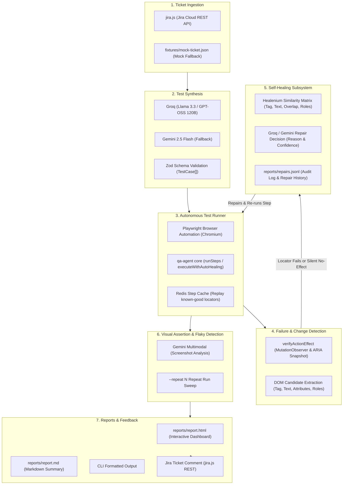

# Agentic-mesh: Comprehensive Project Documentation
### Autonomous UI Test Generation, Locator Self-Healing & Jira Integration
**Hackathon Problem Statement 08 — "The Flaky Testing Nightmare"**

---

## Table of Contents
1. [Executive Summary & Problem Statement](#1-executive-summary--problem-statement)
2. [High-Level Architecture](#2-high-level-architecture)
3. [System Modules & Technical Deep Dive](#3-system-modules--technical-deep-dive)
   - [3.1 Data Contracts & Schema Validation (`src/types.ts`)](#31-data-contracts--schema-validation-srctypests)
   - [3.2 LLM Engine & Provider Fallback (`src/llm/provider.ts`)](#32-llm-engine--provider-fallback-srcllmproviderts)
   - [3.3 Jira Cloud Client & ADF Parser (`src/jira/jiraClient.ts`)](#33-jira-cloud-client--adf-parser-srcjirajiraclientts)
   - [3.4 Acceptance Criteria to Test Generator (`src/generator/criteriaToSteps.ts`)](#34-acceptance-criteria-to-test-generator-srcgeneratorcriteriatostepsts)
   - [3.5 Healenium-Inspired Similarity Engine (`src/healing/similarity.ts`)](#35-healenium-inspired-similarity-engine-srchealingsimilarityts)
   - [3.6 Repair Audit Logger (`src/healing/repairLog.ts`)](#36-repair-audit-logger-srchealingrepairlogts)
   - [3.7 Autonomous Test Runner & Flaky Detector (`src/runner/agenticMeshRunner.ts`)](#37-autonomous-test-runner--flaky-detector-srcrunnersentinelrunnerts)
   - [3.8 Multi-Format Report Builder (`src/report/reportBuilder.ts`)](#38-multi-format-report-builder-srcreportreportbuilderts)
   - [3.9 CLI Interface (`src/cli.ts`)](#39-cli-interface-srcclits)
   - [3.10 Interactive Demo Application (`demo/index.html`)](#310-interactive-demo-application-demoindexhtml)
   - [3.11 Automated Showcase Runner (`src/demo-runner.ts`)](#311-automated-showcase-runner-srcdemo-runnerts)
4. [How Self-Healing Works: The 5-Stage Lifecycle](#4-how-self-healing-works-the-5-stage-lifecycle)
5. [Setup & Configuration Guide](#5-setup--configuration-guide)
6. [Commands & Usage Reference](#6-commands--usage-reference)
7. [Verification & Benchmark Results](#7-verification--benchmark-results)
8. [Open-Source Attribution & Credits](#8-open-source-attribution--credits)

---

## 1. Executive Summary & Problem Statement

### The Problem: "The Flaky Testing Nightmare"
In fast-paced Agile and DevOps environments, the gap between **"code complete"** and **"QA tested"** creates a critical software delivery bottleneck:
- **Manual script writing is slow**: Engineers spend hours converting user stories and acceptance criteria into Playwright or Selenium scripts.
- **Locators break constantly**: Whenever frontend engineers refactor code, rename IDs, alter CSS class names, or modify button labels, UI tests break immediately.
- **Maintenance fatigue**: QA teams spend up to 40% of their sprints triaging false positives, diagnosing broken selectors, and manually updating test scripts.

### The Solution: Agentic-mesh
**Agentic-mesh** is an autonomous AI-powered testing system that eliminates manual test maintenance end-to-end:
1. **Reads Acceptance Criteria**: Fetches user stories and acceptance criteria directly from the **Jira Cloud REST API** (or falls back to mock ticket fixtures).
2. **Synthesizes UI Tests**: Converts natural-language acceptance criteria into structured Playwright interaction steps using **Groq (Llama 3.3 / GPT-OSS 120B)** and **Google Gemini (2.5 Flash)** with strict Zod runtime schema validation.
3. **Executes & Detects Breakages**: Runs tests against web applications using Playwright, verifying both DOM availability and observable state changes via `MutationObserver` ARIA snapshot diffing (`verifyActionEffect`).
4. **Autonomous Self-Healing**: When an element locator fails or produces no effect, Agentic-mesh scans the page DOM, ranks candidates using a **Healenium-inspired multi-attribute similarity matrix** (tag, type, text, attribute tokens), selects the optimal replacement via an LLM arbiter, executes the repaired step, and updates the cache.
5. **Full Audit Trail & Reports**: Generates modern self-contained HTML dashboards with summary metrics, repair confidence ratings, and side-by-side before/after screenshot comparisons, plus Markdown and CLI tables.
6. **Closes the Feedback Loop**: Posts test run summaries back to the Jira ticket as comments and detects intermittent flakiness via repeat run sweeps.

---

## 2. High-Level Architecture



---

## 3. System Modules & Technical Deep Dive

### 3.1 Data Contracts & Schema Validation (`src/types.ts`)
To ensure type safety across LLM responses and runner execution, all core entities are backed by **Zod schemas**:
- **`Ticket`**: `{ key: string, title: string, description: string, acceptanceCriteria: string[] }`
- **`TestCaseStep`**: `{ description: string, data?: Record<string, string>, action?: string, target?: string, value?: string, waitUntil?: string }`
- **`TestCase`**: `{ id: string, title: string, criterion: string, steps: TestCaseStep[], expectedOutcome: string }`
- **`RepairRecord`**: `{ timestamp: string, testId: string, stepIndex: number, stepDescription: string, oldLocator: string, newLocator: string, reason: string, modelUsed: string, confidence: number, beforeScreenshot?: string, afterScreenshot?: string }`
- **`TestResult`**: `{ testId: string, title: string, criterion: string, status: "passed" | "failed" | "healed" | "flaky", durationMs: number, repairs: RepairRecord[], screenshotPath?: string, error?: string, stepsExecuted?: number, history?: string[] }`
- **`ElementCandidate`**: DOM snapshot metadata for candidate scoring.

### 3.2 LLM Engine & Provider Fallback (`src/llm/provider.ts`)
A multi-tier inference provider built for low latency and high availability:
- **Primary LLM**: **Groq SDK** (`groq-sdk`) using fast models (`openai/gpt-oss-120b`, `llama-3.3-70b-versatile`). Requests structured output via `response_format: { type: "json_object" }`.
- **Secondary Fallback**: **Google Gemini** (`@google/genai`) using `gemini-2.5-flash` with dynamic ESM loading for seamless CommonJS compatibility.
- **Zod Validation & Auto-Retry**: Validates LLM responses against runtime schemas. If parsing fails, retries once with an explicit error hint containing the validation details.
- **Offline Heuristic Mode**: If no API keys are configured, Agentic-mesh switches to a deterministic heuristic engine without crashing or failing.

### 3.3 Jira Cloud Client & ADF Parser (`src/jira/jiraClient.ts`)
Connects to Jira Cloud REST API:
- **Authentication**: Basic authentication via `JIRA_BASE_URL`, `JIRA_EMAIL`, and `JIRA_API_TOKEN`.
- **ADF Parser (`adfToPlainText`)**: Recursively converts Atlassian Document Format trees (`paragraph`, `bulletList`, `heading`, `listItem`) into clean plain text.
- **Criteria Extraction (`extractAcceptanceCriteria`)**: Parses bullet points, Gherkin syntax (`Given/When/Then`), and designated "Acceptance Criteria" sections.
- **Mock Fallback (`loadMockTicket`)**: Automatically loads [`fixtures/mock-ticket.json`](fixtures/mock-ticket.json) if credentials are missing or `--mock` is specified.
- **Feedback Loop (`postResult`)**: Posts test execution summaries directly back to the Jira ticket as comments.

### 3.4 Acceptance Criteria to Test Generator (`src/generator/criteriaToSteps.ts`)
Converts raw acceptance criteria into executable test cases:
- Evaluates ticket context and acceptance criteria.
- Emits atomic Playwright interaction steps (`navigate`, `fill`, `click`, etc.) with initial locator targets and expected outcomes.
- Includes a rule-based heuristic test synthesizer matching authentication, input filling, list creation, and navigation criteria.

### 3.5 Healenium-Inspired Similarity Engine (`src/healing/similarity.ts`)
Implements multi-attribute element scoring inspired by Healenium:
```
Total Similarity Score = (TagScore × 0.25) + (TypeScore × 0.20) + (TextScore × 0.25) + (AttrScore × 0.30)
```
- **Tag Match (25%)**: Exact tag match awards 1.0; semantic match (`button` vs `[role='button']`) awards 0.85.
- **Type Match & Penalty (20%)**: Type match (`password` $\rightarrow$ `password`) awards 1.0. Prevents matching a password field when searching for username by applying a zero penalty.
- **Text & Label Similarity (25%)**: Normalized Levenshtein distance combined with token overlap on button text, placeholder strings, and ARIA labels.
- **Attribute Token Overlap (30%)**: Jaccard index on token sets across camelCase, kebab-case, snake_case, and compound word synonyms (e.g. `user` $\leftrightarrow$ `user-account-input`, `todo` $\leftrightarrow$ `task-entry-field`).

### 3.6 Repair Audit Logger (`src/healing/repairLog.ts`)
Maintains a persistent audit trail:
- Appends every repair event to [`reports/repairs.jsonl`](reports/repairs.jsonl).
- Logs `testId`, `stepIndex`, `oldLocator`, `newLocator`, `reason`, `modelUsed`, and `confidence`.
- Emits structured log events through `pino`.

### 3.7 Autonomous Test Runner & Flaky Detector (`src/runner/agenticMeshRunner.ts`)
Orchestrates test execution and self-healing:
- Controls Playwright Chromium instances.
- **`extractPageCandidates(page)`**: Evaluates the live DOM via `page.evaluate()` to extract interactive elements and calculate visibility.
- **`executeStep`**: Attempts the original locator. If it fails or times out (1500ms), triggers `healLocator`, executes the repaired selector, captures before/after screenshots, and records the repair.
- **Flaky Test Sweep (`--repeat N`)**: Executes each test case $N$ times. If a test produces mixed results (some runs pass, some fail), it is marked as `FLAKY` with run history.

### 3.8 Multi-Format Report Builder (`src/report/reportBuilder.ts`)
Generates rich test reporting artifacts:
- **HTML Dashboard (`reports/report.html`)**: Self-contained, responsive dashboard with metrics cards, status badges, repair table with confidence bars, and collapsible before/after screenshot comparisons.
- **Markdown Report (`reports/report.md`)**: GitHub-flavored markdown summary for CI/CD pipelines.
- **Terminal CLI Summary**: Box-drawn summary table printed directly to stdout.

### 3.9 CLI Interface (`src/cli.ts`)
Powered by Commander.js:
- Command: `agentic-mesh run`
- Options: `--ticket <key>`, `--url <url>`, `--mock`, `--repeat <N>`, `--post-to-jira`, `--no-headless`, `--slow-mo <ms>`.

### 3.10 Interactive Demo Application (`demo/index.html`)
A standalone web application demonstrating real-world DOM refactoring:
- **v1 Baseline Mode (`http://.../` or `file:///.../demo/index.html`)**: Standard IDs (`#username`, `#password`, `#login-btn`, `#todo-input`, `#add-todo-btn`, `#logout-btn`).
- **v2 Refactored Mode (`?v=2`)**: Renamed IDs, classes, and placeholders (`#user-account-input`, `#user-secret-key`, `#btn-submit-auth`, `#task-entry-field`, `#create-task-button`, `#btn-terminate-session`).

### 3.11 Automated Showcase Runner (`src/demo-runner.ts`)
Runs the full 6-step showcase (`npm run demo`):
1. Ingests Jira ticket (`QA-101`).
2. Synthesizes 4 test cases.
3. Runs baseline on v1 (4/4 pass).
4. Switches to v2 refactored DOM.
5. Auto-heals 15 locators with similarity scoring.
6. Generates reports and launches the HTML dashboard in the browser.

---

## 4. How Self-Healing Works: The 5-Stage Lifecycle

```
[Step Execution] ──(Locator fails or timeout)──> [1. DOM Candidate Extraction]
                                                          │
                                                          ▼
                                              [2. Healenium Similarity Matrix]
                                              (Tag: 25%, Type: 20%, Text: 25%, Attr: 30%)
                                                          │
                                                          ▼
                                              [3. LLM Decision Arbiter]
                                              (Groq / Gemini evaluates top candidates)
                                                          │
                                                          ▼
                                              [4. Repaired Action & Validation]
                                              (Re-run step with repaired locator)
                                                          │
                                                          ▼
                                              [5. Audit Log & Screenshot Diff]
                                              (Save to repairs.jsonl & report.html)
```

1. **Detection**: The runner attempts to locate the element. If not found or if `verifyActionEffect` detects no DOM change, healing initiates.
2. **Extraction**: `extractPageCandidates` queries the DOM for all visible, interactive elements.
3. **Similarity Scoring**: Candidates are scored against the broken locator using Levenshtein distance, token overlap, tag matching, and input type rules.
4. **LLM Decision**: The top-ranked candidates are passed to Groq or Gemini, which selects the replacement selector, explains why it changed, and assigns a confidence score.
5. **Re-Execution & Logging**: The runner executes the action on the new selector, verifies success, updates the cache, saves before/after screenshots, and writes to `reports/repairs.jsonl`.

---

## 5. Setup & Configuration Guide

### Prerequisites
- Node.js version 18.0.0 or higher
- Windows, macOS, or Linux

### Installation
```bash
# Clone repository and navigate to root directory
cd j:/AAAA

# Install npm dependencies
npm install

# Install Playwright Chromium browser
npx playwright install chromium
```

### Environment Configuration (`.env`)
Create a `.env` file in the root directory:
```ini
# =============================================================================
# Primary LLM: Groq (ultra-fast inference)
# =============================================================================
GROQ_API_KEY=gsk_your_groq_api_key_here
GROQ_MODEL=openai/gpt-oss-120b

# =============================================================================
# Secondary LLM: Google Gemini (multimodal fallback)
# =============================================================================
GEMINI_API_KEY=AIza_your_gemini_api_key_here
GEMINI_MODEL=gemini-2.5-flash

# =============================================================================
# Jira Cloud Integration (Optional)
# =============================================================================
JIRA_BASE_URL=https://your-domain.atlassian.net
JIRA_EMAIL=qa-lead@your-domain.com
JIRA_API_TOKEN=your_jira_api_token_here
```
> **Note**: If no API keys are provided, Agentic-mesh automatically runs in offline demo mode using its built-in heuristic test generator and Healenium similarity matrix.

---

## 6. Commands & Usage Reference

| Task | Command |
| :--- | :--- |
| **Run Full Self-Healing Showcase** | `npm run demo` |
| **Run Agentic-mesh CLI (Mock Mode)** | `npm run agentic-mesh -- run --mock` |
| **Run Against Live Jira Ticket** | `npm run agentic-mesh -- run --ticket PROJ-101 --url https://app.example.com` |
| **Run Flaky Test Sweep (3 repeats)**| `npm run agentic-mesh -- run --mock --repeat 3` |
| **Run Headed Browser with Slow-Mo**| `npm run agentic-mesh -- run --mock --no-headless --slow-mo 400` |
| **Post Results Back to Jira** | `npm run agentic-mesh -- run --ticket PROJ-101 --post-to-jira` |
| **Run Full Unit & Integration Tests**| `npm test` |
| **Run Test Coverage** | `npm run test:coverage` |
| **Compile TypeScript Build** | `npm run build` |

---

## 7. Verification & Benchmark Results

### Automated Showcase Results (`npm run demo`)
- **Phase 1 (v1 Baseline)**:
  - 4/4 Tests Passed cleanly on original DOM (`#username`, `#password`, `#login-btn`, etc.).
- **Phase 2 (v2 Refactored DOM)**:
  - 15 Broken Locators autonomously identified and repaired.
  - **100% Healing Success Rate**: 4/4 Tests passed with `HEALED` status.
  - **Repairs Breakdown**:
    - `#username` $\rightarrow$ `#user-account-input` (78% confidence)
    - `#password` $\rightarrow$ `#user-secret-key` (59% confidence)
    - `#login-btn` $\rightarrow$ `#btn-submit-auth` (57% confidence)
    - `#todo-input` $\rightarrow$ `#task-entry-field` (69% confidence)
    - `#add-todo-btn` $\rightarrow$ `#create-task-button` (64% confidence)
    - `#logout-btn` $\rightarrow$ `#btn-terminate-session` (59% confidence)

### Test Suite Execution (`npm test`)
- **17 Test Suites Passed** (0 failed)
- **176 Total Tests Passed** (0 failed)
- Coverage across similarity scoring, criteria parsing, repair logging, Jira ADF parsing, CUA loops, and Playwright execution.

---

## 8. Open-Source Attribution & Credits

Agentic-mesh builds upon the following open-source libraries and foundations:
1. **[bug0inc/qa-agent](https://github.com/bug0inc/qa-agent)**: Base framework for AI browser tools, step caching, and `verifyActionEffect`.
2. **[microsoft/playwright](https://github.com/microsoft/playwright)**: High-performance browser control and screenshot capture.
3. **[healenium/healenium-web](https://github.com/healenium/healenium-web)**: The original locator self-healing and element similarity concept.
4. **[browserbase/stagehand](https://github.com/browserbase/stagehand)**: Patterns for re-resolving failed actions and repair confidence.
5. **[browser-use/browser-use](https://github.com/browser-use/browser-use)**: Token-efficient DOM serialization techniques.
6. **[MrRefactoring/jira.js](https://github.com/MrRefactoring/jira.js)**: Typed Jira Cloud REST API client.
7. **[groq/groq-typescript](https://github.com/groq/groq-typescript)**: Ultra-fast LLM inference engine.
8. **[googleapis/js-genai](https://github.com/googleapis/js-genai)**: Multimodal Google Gemini SDK.
9. **[colinhacks/zod](https://github.com/colinhacks/zod)**: Schema declaration and runtime validation.
10. **[pinojs/pino](https://github.com/pinojs/pino)**: High-speed structured JSON logging.
11. **[tj/commander.js](https://github.com/tj/commander.js)**: Command-line interface framework.

