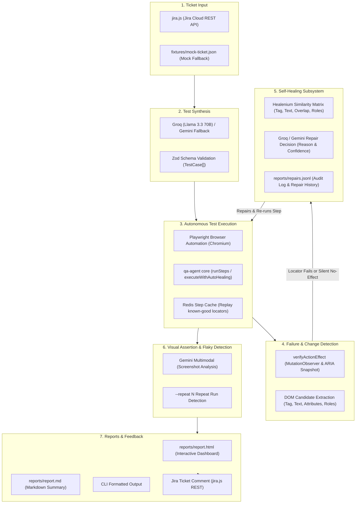
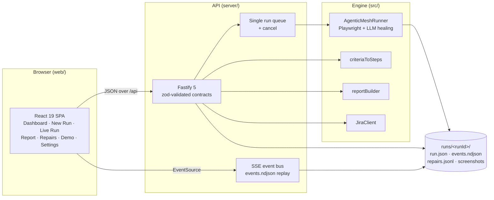
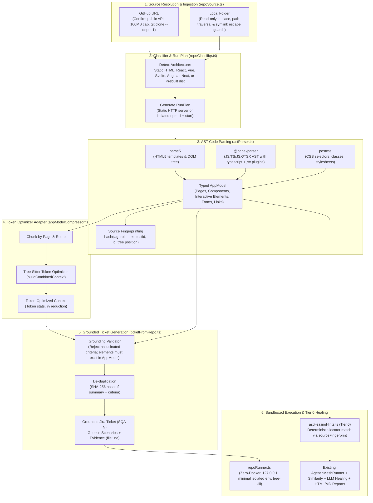
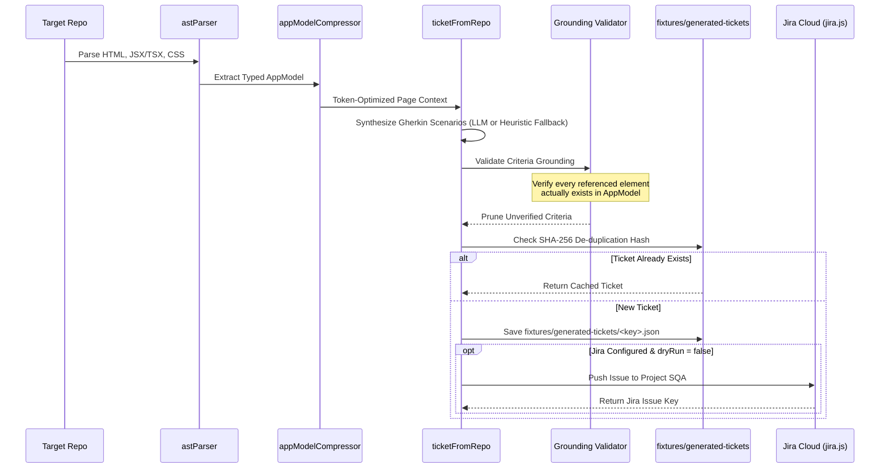

# Agentic-mesh 🛡️
### Autonomous UI Test Generation, Self-Healing Locators & Jira Integration


Agentic-mesh transforms Jira acceptance criteria into automated, executable Playwright UI tests, runs them against modern web applications, autonomously self-heals broken or refactored DOM locators using a hybrid Healenium-inspired similarity pre-filter and LLM decision engine, and produces interactive visual reports with full repair audit trails.

---

## 🚀 The 3-Command Showcase

Get Agentic-mesh running in under 60 seconds:

```bash
# 1. Install dependencies
npm install

# 2. Run the complete self-healing showcase (v1 baseline -> v2 refactor -> auto-heal -> HTML report)
npm run demo

# 3. Run the CLI against any ticket, custom URL, or flaky test repeat cycle
npm run agentic-mesh -- run --mock --repeat 1
```

---

## 🏛️ Architecture & End-to-End Workflow



---

## 🧠 How Self-Healing Works

When a frontend team refactors an application (renaming IDs, changing CSS classes, updating labels, or switching button tags), traditional test suites break. Agentic-mesh repairs these broken steps autonomously in five phases:

1. **Failure & Silent Breakage Detection**:
   When a step executes, Agentic-mesh first monitors whether the element is visible and interactive. In addition, `verifyActionEffect` compares pre- and post-action ARIA snapshots via `MutationObserver` to ensure the action produced an observable page state change. If an action fails or produces no effect, self-healing activates immediately.

2. **DOM Candidate Extraction**:
   Agentic-mesh queries the active document DOM to extract all interactive candidates (`input`, `button`, `a`, `select`, `textarea`, `[role='button']`, `[role='textbox']`). For each candidate, it records its tag, ID, name, input type, placeholder, ARIA label, classes, inner text, and computed visibility.

3. **Healenium-Inspired Similarity Pre-Filter**:
   Before making expensive LLM calls, candidate elements are scored against the broken locator using a multi-attribute similarity matrix:
   - **Tag & Semantic Role Match (Weight: 25%)**: Exact tag match (`<input>` vs `<input>`) or semantic match (`<button>` vs `<div role="button">`).
   - **Interactive Type Match (Weight: 20%)**: Matches input types (`text`, `password`, `submit`) while heavily penalizing forbidden mismatches (e.g., matching a password input when looking for a username).
   - **Text & Label Similarity (Weight: 25%)**: Levenshtein distance and token overlap against button text, placeholder strings, and ARIA labels.
   - **Attribute & Identifier Token Overlap (Weight: 30%)**: Substring and Jaccard token overlap across camelCase, kebab-case, snake_case, and common synonyms (e.g. `user` $\leftrightarrow$ `user-account-input`, `todo` $\leftrightarrow$ `task-entry-field`).

4. **LLM Decision Arbiter**:
   The top similarity-ranked candidates are passed to **Groq (`llama-3.3-70b-versatile`)** with automatic fallback to **Google Gemini (`gemini-2.5-flash`)**. The LLM evaluates the intended step, explains what changed in the DOM, selects the repaired locator, and computes a confidence score ($0.0 - 1.0$). If running fully offline, Agentic-mesh uses the top similarity candidate directly.

5. **Re-Execution, Audit Logging & Report Generation**:
   The repaired locator is re-executed immediately on the active page. Upon success, a structured `RepairRecord` is appended to `reports/repairs.jsonl`, before-and-after screenshots are archived, and the repair is rendered in `reports/report.html`.

---

## 💻 CLI Commands & Options

Run tests autonomously via the Agentic-mesh CLI:

```bash
# Run against a Jira ticket with mock fallback
npm run agentic-mesh -- run --ticket QA-101 --url http://localhost:3000

# Force mock mode (offline demo)
npm run agentic-mesh -- run --mock

# Flaky test detection (runs tests 3 times to detect intermittent failures)
npm run agentic-mesh -- run --mock --repeat 3

# Run headed browser with slow motion for demo visibility
npm run agentic-mesh -- run --mock --no-headless --slow-mo 500

# Post summary comment back to Jira ticket
npm run agentic-mesh -- run --ticket QA-101 --post-to-jira
```

---

## 🖥️ Frontend — the Agentic-mesh Web Console

The engine ships with a full web console: a thin Fastify API (`server/`) in front of
the existing runner, and a React 19 + Vite 7 + Tailwind v4 single-page app (`web/`).
Both are **additive** — the CLI and `npm run demo` are untouched (see
[CHANGES.md](CHANGES.md)).



### 3 commands to see it

```bash
# 1. API on :8787 in mock mode (no LLM keys, no Jira, no browser downloads)
#    PowerShell: $env:UI_MOCK="1"; npm run dev:api
UI_MOCK=1 npm run dev:api

# 2. Console on :5173 (proxies /api to the server)
npm run dev:ui

# 3. Open http://localhost:5173 -> Start a run -> Fetch ticket -> Continue -> Start run
```

That flow gives you a **live self-healing run**: the agent streams every step over
SSE, a healing banner slides in when a locator is repaired, and the repair lands in
the **Repairs Center** for human approval.

### What is in the console

| Page | What it answers |
| :--- | :--- |
| **Dashboard** | Fleet health: pass-rate trend, outcome split, runs awaiting review, queue state |
| **Connect Repo** | Ingest GitHub repo or local folder -> AST parse -> grounded SQA Jira ticket -> test run |
| **New Run** | Ticket -> editable test plan -> target/version/repeat -> start |
| **Live Run** | Streaming step timeline, reasoning, animated healing banner, cancel |
| **Run Report** | Overview · Tests · Repairs (diff + before/after screenshots) · Flaky heatmap · Visual · Export |
| **Run History** | Every run, filterable by ticket and status, with pass-rate bars |
| **Repairs Center** | Review queue with approve / reject / revert-and-clear-cache |
| **Demo Controls** | Flip the bundled demo app between v1 and v2, or run the whole showcase in one click |
| **Settings** | Model names, repeat default, theme, allow-listed targets, provider status |

Status is always colour **and** icon **and** text (passed = green, failed = red,
healed = amber, flaky = violet); the console is dark-first with a light theme, fully
keyboard navigable, and every panel has loading, empty and error states.

### API surface

All responses are `zod`-validated against [`shared/contracts.ts`](shared/contracts.ts) on
the server **and** the client, so contract drift fails loudly instead of rendering
garbage.

| Method | Route | Purpose |
| :--- | :--- | :--- |
| `GET` | `/api/health` | Version, mock mode, provider + queue status |
| `POST` | `/api/ticket/fetch` | Jira ticket (mock fixture when Jira is not configured) |
| `POST` | `/api/tests/generate` | Acceptance criteria -> test cases |
| `POST` / `GET` | `/api/runs` | Start a run / list runs |
| `GET` | `/api/runs/:id` | Run detail (planned tests, results, steps, repairs, flaky) |
| `GET` | `/api/runs/:id/events` | SSE stream with `Last-Event-ID` replay |
| `POST` | `/api/runs/:id/cancel` | Cancel a queued or active run |
| `GET` | `/api/runs/:id/artifacts/*` | Screenshots and other run artifacts (path-guarded) |
| `GET` | `/api/runs/:id/export` | `?format=html\|md\|json` engine report |
| `GET` / `POST` | `/api/repairs` · `/api/repairs/:id/review` | Repair queue + human review |
| `POST` | `/api/demo/app-version` | Switch the bundled demo app between v1/v2 |
| `POST` | `/api/jira/post-result` | Post the summary to Jira (`dryRun` defaults to `true`) |
| `GET` | `/api/stats` | Aggregates for the dashboard |
| `GET` / `PUT` | `/api/settings` | Models, repeat default, theme, demo version |
| `POST` | `/api/repo/connect` | Ingest repository (URL or local folder), classify, parse AST, compress with Token Optimizer, generate Jira ticket, launch locally, run Playwright tests, and teardown |
| `POST` | `/api/repo/ticket` | Ingest repository and synthesize a grounded Jira SQA ticket with acceptance criteria & evidence |

**Safety:** LLM and Jira credentials never reach the browser — they stay in the
server-side environment. Runs are serialised through a one-at-a-time queue, targets
must match the `ALLOWED_TARGETS` allowlist (demo app, localhost, saucedemo.com by
default), artifact paths are traversal-checked, and the Jira post is a dry run unless
you explicitly ask otherwise.

### Working on the console

```bash
npm run typecheck:ui     # tsc --noEmit for web/
npm run typecheck:server # tsc --noEmit for server/
npm run test:ui          # vitest + Testing Library (status tones, live model, api, components)
npm run test:e2e         # Playwright: dashboard -> mock run -> healing banner -> approve repair
npm run build:ui         # production bundle in web/dist
```

The e2e suite starts both servers itself in `UI_MOCK` mode and needs no keys.

---

## 🌐 Autonomous Repo Ingestion & Jira Ticket Synthesis (Task 1 & Task 2)

Agentic-mesh includes an end-to-end repository ingestion pipeline that connects to any public GitHub repository (e.g. `https://github.com/TaruN-Ruwali/UI_Test.git`) or local directory, extracts structural UI semantics via full AST parsing, compresses context with the Tree-Sitter Token Optimizer, generates grounded Jira tickets (project key `SQA`), boots the application locally with a zero-Docker safety sandbox, and runs the entire self-healing test lifecycle.

### 🚀 Repo-Connect Quickstart

#### 1. Via Agentic-mesh Web Console
1. Start the API and Console:
   ```bash
   npm run dev:api    # Fastify API on :8787
   npm run dev:ui     # Vite console on :5173
   ```
2. In the sidebar, click **Connect Repo** (`/repo`).
3. Enter a public GitHub URL (e.g. `https://github.com/TaruN-Ruwali/UI_Test.git`) or a local directory path (e.g. `d:/Agentic-mesh/UI_Test`).
4. Choose an action:
   - **Generate SQA Ticket Only**: Extracts the AppModel, optimizes tokens, and generates a draft SQA ticket with full Gherkin criteria and source element evidence in an editable preview.
   - **Connect & Run Full Pipeline**: Ingests, parses, generates the ticket, launches the app locally on a free port, executes the Playwright test suite with Tier 0 deterministic locator healing, and displays the execution report.
5. All runs display an audit banner: `Third-party repo, tested locally, commit <sha>`.

#### 2. Via Programmatic TypeScript SDK
```typescript
import { connectRepo } from "./src/repo/orchestrator.js";

const result = await connectRepo({
  url: "https://github.com/TaruN-Ruwali/UI_Test.git",
  // Or local path: localPath: "d:/Agentic-mesh/UI_Test",
  generateTicket: true,
  dryRun: true,
  onProgress: (stage, message, data) => {
    console.log(`[${stage.toUpperCase()}] ${message}`);
  }
});

console.log("Synthesized SQA Ticket:", result.ticket?.key, result.ticket?.title);
console.log("Token Savings:", result.tokenSavings?.percentSaved, "%");
console.log("Test Outcome:", result.executionResult?.summary);
```

#### 3. Via REST API
```bash
# Generate a grounded SQA ticket from a local repo or cloned URL:
curl -X POST http://127.0.0.1:8787/api/repo/ticket \
  -H "Content-Type: application/json" \
  -d '{"localPath": "d:/Agentic-mesh/UI_Test", "dryRun": true}'

# Execute the full autonomous ingestion -> AST -> ticket -> local run -> test pipeline:
curl -X POST http://127.0.0.1:8787/api/repo/connect \
  -H "Content-Type: application/json" \
  -d '{"localPath": "d:/Agentic-mesh/UI_Test", "generateTicket": true, "dryRun": true}'
```

---

### 🧬 AST Parsing & Optimization Pipeline

Rather than relying on naive regex matching or scraping, Agentic-mesh uses production-grade language parsers to inspect the exact syntax tree of the target repository:



#### Parsers & Components Used:
- **HTML (`parse5`)**: Traverses DOM nodes, extracting forms, inputs, buttons, links, `data-testid`, IDs, ARIA attributes, and inner text.
- **JavaScript / TypeScript / JSX / TSX (`@babel/parser`)**: Uses `@babel/parser` with `jsx` and `typescript` plugins to inspect ASTs, identifying React/JSX components, interactive JSX elements (`onClick`, `onSubmit`), input fields, and navigation links.
- **CSS (`postcss`)**: Parses stylesheets to extract class names, CSS selectors, and responsive rules.
- **Source Fingerprinting**: Every interactive element is tagged with a stable `sourceFingerprint`: `hash(tag, role, text, testid, id, treePosition)`. When a locator breaks, Tier 0 healing uses this fingerprint to immediately identify the refactored element in the live DOM.
- **AppModel Token Compressor**: Thin adapter to the existing Tree-Sitter Token Optimizer (`buildCombinedContext` & `countTokens`), chunking elements by page and generating token savings statistics before feeding the LLM.

---

### 🎫 Grounded Jira Ticket Generation Flow (Task 2)

Agentic-mesh reads the target codebase exclusively through the typed `AppModel` to synthesize actionable Jira tickets in project `SQA`:



#### Ticket Characteristics:
- **Format Parity**: Produces tickets matching `fixtures/demo-tickets.json` (`key`: next available `SQA-N`, `summary`, `title`, `description`, `acceptanceCriteria`, `labels: ["agentic-mesh-generated"]`, `evidence[]`, `reviewNotice`).
- **Strict Grounding**: Every acceptance criterion must be grounded in real interactive elements found in the `AppModel`. Hallucinated or speculative criteria are dropped by the grounding validator.
- **Evidence Trail**: Each criterion includes `evidence[]` tracing the exact element tags, roles, text, and `file:line` references from which it was synthesized.
- **Offline Heuristic Synthesis**: When running without LLM keys, Agentic-mesh automatically derives deterministic Given/When/Then scenarios from parsed forms, buttons, and navigation elements.
- **Safety Labeling**: Generated criteria are explicitly labeled `"auto-generated, needs human review"` in the UI and test reports. Never presented as human-authored.
- **De-duplication**: Computes a SHA-256 hash of `summary + acceptanceCriteria`; duplicate generation requests return the existing ticket.

---

### 🛡️ Safety & Sandbox Model (Zero Docker)

To ensure maximum speed, security, and simplicity without Docker overhead, Agentic-mesh enforces a strict multi-layer sandbox:

| Security Vector | Enforcement Mechanism |
| :--- | :--- |
| **No Docker Requirement** | Operates 100% via native local OS child processes (`child_process.spawn`). Zero container dependencies. |
| **Read-Only Local Repositories** | Local folders are inspected in place, read-only. For applications requiring `npm install` or build steps, Agentic-mesh automatically clones the codebase into an isolated temporary directory (`os.tmpdir()`), leaving the original codebase untouched. |
| **Zero Secret Leakage** | Child processes are spawned with an explicitly whitelisted environment (`PATH`, `HOME`, `PORT`, `NODE_ENV`, `HOST=127.0.0.1`). `process.env` is **never** spread to child processes. `JIRA_*`, `GROQ_*`, `GEMINI_*`, and all host environment secrets are completely stripped. |
| **Port & Network Isolation** | Servers bind strictly to `127.0.0.1` on random OS-allocated free ports (avoiding port collisions and external network exposure). |
| **Path Traversal Protection** | The built-in static HTTP server rejects any URL containing `..` or escaping the document root with immediate `403 Forbidden` responses. |
| **Subprocess Teardown** | All launched child processes are tracked and cleanly terminated using `tree-kill` on exit or teardown. Temporary clone directories are safely wiped. |
| **Untrusted Code Warning** | Repositories with unknown dependencies require explicit `confirmUntrusted: true` confirmation and display an audit banner: `Third-party repo, tested locally, commit <sha>`. |

---

## ⚙️ Environment Variables

Create a `.env` file in the root directory (see `.env.example`):

| Variable | Required | Description | Default |
| :--- | :--- | :--- | :--- |
| `GROQ_API_KEY` | Optional* | Ultra-fast test synthesis & repair decision engine | - |
| `GROQ_MODEL` | Optional | Groq model identifier | `llama-3.3-70b-versatile` |
| `GEMINI_API_KEY` | Optional* | Multimodal visual assertions & fallback LLM | - |
| `GEMINI_MODEL` | Optional | Google Gemini model identifier | `gemini-2.5-flash` |
| `JIRA_BASE_URL` | Optional | Jira Cloud URL (`https://your-domain.atlassian.net`) | - |
| `JIRA_EMAIL` | Optional | Jira user email for basic auth | - |
| `JIRA_API_TOKEN` | Optional | Jira Cloud API token | - |
| `REDIS_URL` | Optional | Redis connection string for step caching | `redis://localhost:6379` |

Web API (`server/`) — see `.env.example` for the full block:

| Variable | Required | Description | Default |
| :--- | :--- | :--- | :--- |
| `PORT` / `HOST` | Optional | API bind address | `8787` / `127.0.0.1` |
| `UI_MOCK` | Optional | `1` serves deterministic mock runs (no keys, no browser) | off |
| `RUNS_DIR` | Optional | Where run artifacts are written | `runs/` |
| `ALLOWED_TARGETS` | Optional | Comma-separated target allowlist (replaces the defaults) | demo app + localhost + saucedemo.com |
| `UI_HEADED` | Optional | `1` runs the agent browser visibly | off |
| `RATE_LIMIT_PER_MINUTE` | Optional | Fixed-window API rate limit per IP | `240` |

*\*If no API keys are provided, Agentic-mesh automatically operates in robust offline demo mode using intelligent heuristic test synthesis and Healenium similarity matrix scoring.*

---

## 🧪 Unit & Integration Testing

Agentic-mesh includes a comprehensive test suite covering test generation, similarity scoring, repair logging, and Jira ADF parsing:

```bash
# Run all unit tests
npm test

# Run tests with coverage
npm run test:coverage
```

---

## 📦 Project Structure

```
├── demo/
│   └── index.html               # Interactive showcase app with v1 and ?v=2 refactored modes
├── docs/                        # Complete technical & architectural documentation
│   ├── PROJECT_OVERVIEW.md      # Executive summary, mission & value proposition
│   ├── PROBLEM_STATEMENT.md     # Hackathon PS 08 analysis & compliance matrix
│   ├── SOLUTION_APPROACH.md     # 6-stage autonomous pipeline & healing methodology
│   ├── SYSTEM_ARCHITECTURE.md   # Component diagrams, sequence charts & state machines
│   ├── TECH_STACK.md            # Technology stack evaluation & dependency matrix
│   ├── API_DOCUMENTATION.md     # CLI reference, TypeScript SDK & Zod schemas
│   ├── SETUP_GUIDE.md           # Step-by-step installation, run guides & FAQ
│   └── FUTURE_SCOPE.md          # 3-horizon production roadmap & enterprise scale
├── fixtures/
│   └── mock-ticket.json         # Realistic Jira ticket with 4 acceptance criteria
├── reports/
│   ├── report.html              # Modern, standalone self-healing report dashboard
│   ├── report.md                # Markdown execution summary
│   ├── repairs.jsonl            # Structured JSONL repair audit trail
│   └── screenshots/             # Failure and before/after repair screenshots
├── src/
│   ├── cli.ts                   # Commander.js CLI interface (`agentic-mesh run ...`)
│   ├── demo-runner.ts           # End-to-end 6-step demo runner (`npm run demo`)
│   ├── types.ts                 # Zod schemas & TypeScript contracts
│   ├── generator/
│   │   └── criteriaToSteps.ts   # Acceptance criteria -> Playwright TestCases generator
│   ├── healing/
│   │   ├── similarity.ts        # Healenium-inspired multi-attribute candidate scoring
│   │   └── repairLog.ts         # Pino structured logging & JSONL repair recorder
│   ├── jira/
│   │   └── jiraClient.ts        # Typed jira.js Cloud client, ADF parser & mock fallback
│   ├── llm/
│   │   └── provider.ts          # Groq + Gemini LLM client with Zod validation & retries
│   ├── report/
│   │   └── reportBuilder.ts     # HTML, Markdown, and CLI table report generator
│   └── runner/
│   │   └── agenticMeshRunner.ts    # Test orchestrator, healing lifecycle & flaky detection
├── shared/
│   └── contracts.ts             # Zod schemas + types shared by the API and the console
├── server/                      # Thin Fastify API in front of the engine
│   └── src/
│       ├── index.ts             # Entrypoint for `npm run dev:api`
│       ├── app.ts               # Plugins, hooks, rate limit, error envelope
│       ├── orchestrator.ts      # One-at-a-time run queue, cancel, persistence
│       ├── events.ts            # SSE bus + events.ndjson replay
│       ├── store.ts             # runs/ and repairs.jsonl readers/writers
│       ├── security.ts          # Target allowlist & artifact path guard
│       ├── settings.ts          # Persisted console settings
│       ├── mock/                # Deterministic fixtures + timed playback (UI_MOCK)
│       └── routes/              # health, intake, runs, repairs, repo, admin (demo/jira/stats/settings)
├── web/                         # React 19 + Vite 7 + Tailwind v4 console
│   ├── index.html
│   └── src/
│       ├── App.tsx              # Router + layout
│       ├── pages/               # Dashboard, ConnectRepo, NewRun, LiveRun, RunReport, RunHistory, RepairsCenter, DemoControls, Settings
│       ├── components/          # StatusBadge, LocatorDiff, ScreenshotCompare, StepTimeline, RepairRow, StatCard…
│       ├── hooks/               # TanStack Query bindings + useRunEvents (SSE)
│       ├── lib/                 # api client, live model fold, status tones, formatters
│       ├── store/               # theme, toasts, live view state (zustand)
│       └── mocks/               # MSW handlers for offline UI work
├── e2e/
│   └── agentic-mesh-console.spec.ts # Playwright: dashboard -> mock run -> heal -> approve repair
├── playwright.config.ts         # Boots API + console itself in UI_MOCK mode
```

## 📚 Documentation Index

For deep dives into every aspect of Agentic-mesh, consult the dedicated documentation suite:

1. [**Project Overview**](docs/PROJECT_OVERVIEW.md) — Executive summary, mission, stakeholder value, and hackathon compliance.
2. [**The Backstory of Agentic-mesh**](docs/BACKSTORY.md) — Narrative origin story: the nightmare, the 36-hour build, and the closed loop.
3. [**Judges Pitch**](docs/JUDGES_PITCH.md) — Full pitch document: problem, innovation, differentiation, ROI, and prepared Q&A.
4. [**Judges Pitch Script (हिन्दी)**](docs/PITCH_SCRIPT_HI.md) — Performable spoken script: problem statement and solution, with timings, demo cues, and Q&A.
5. [**Problem Statement**](docs/PROBLEM_STATEMENT.md) — Detailed breakdown of PS 08 ("The Flaky Testing Nightmare") and industry challenges.
6. [**Solution Approach**](docs/SOLUTION_APPROACH.md) — The 6-stage autonomous pipeline, mathematical similarity matrix, and dual-tier healing.
7. [**System Architecture**](docs/SYSTEM_ARCHITECTURE.md) — Mermaid component diagrams, sequence diagrams, and state machines.
8. [**Technology Stack**](docs/TECH_STACK.md) — Dependency breakdown, version specs, and architectural trade-off evaluations.
9. [**API & CLI Documentation**](docs/API_DOCUMENTATION.md) — Complete CLI options reference, TypeScript programmatic SDK, and Zod schemas.
10. [**Setup & Execution Guide**](docs/SETUP_GUIDE.md) — Step-by-step setup, verification commands, showcase walkthrough, and troubleshooting.
11. [**Demo Suite & Verification Guide**](docs/DEMO_SUITE.md) — Comprehensive guide to the 11 demo applications, Jira test suites, and SQA verification.
12. [**Future Scope**](docs/FUTURE_SCOPE.md) — 3-horizon production roadmap (Git PR auto-patching, vector DOM embeddings, CI/CD plugins).

---
