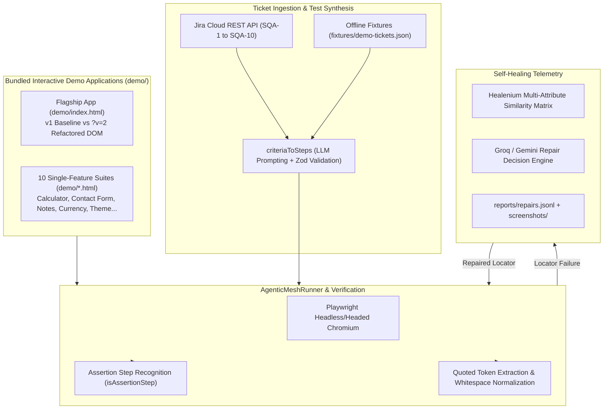
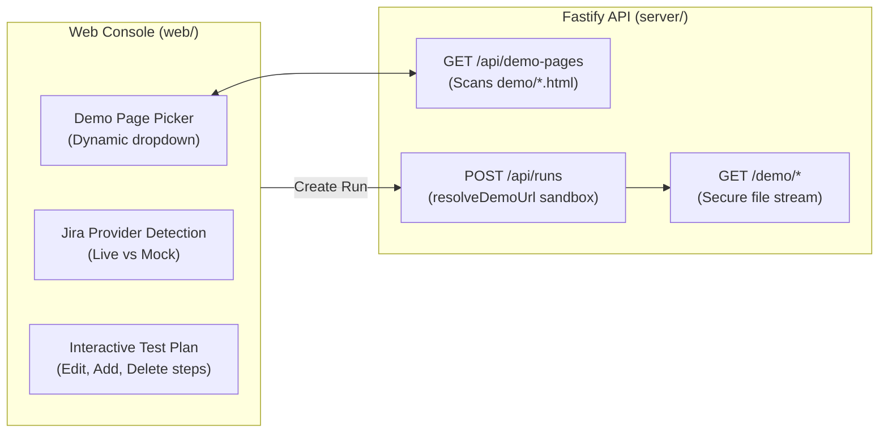

# Agentic-mesh Demo Suite & Comprehensive Verification Guide

> **Detailed Guide to Bundled Interactive Demo Applications, Jira Test Suites (SQA-1 to SQA-10), Web Console Integration, Engine Innovations, and End-to-End Verification Tooling**

---

## 1. Overview & Dual-Mode Architecture

Agentic-mesh provides a comprehensive, production-grade test verification suite consisting of **11 self-contained web applications** paired with corresponding Jira acceptance criteria tickets (`SQA-1` through `SQA-10`). 

These demo environments enable end-to-end verification of:
1. **Natural-language test synthesis** via Groq (`llama-3.3-70b-versatile` / `openai/gpt-oss-120b`) and Google Gemini (`gemini-2.5-flash`).
2. **Autonomous Playwright test execution** across modern interactive UI components.
3. **Dual-tier self-healing** combining Healenium-inspired multi-attribute similarity scoring and LLM semantic arbitration.
4. **Resilient outcome matching** and **assertion-first step execution** without unnecessary synthetic clicks.
5. **Real Jira Cloud synchronization** paired with offline deterministic mock fallback.



---

## 2. Bundled Demo Applications Catalog

The demo suite contains 11 web applications located in `demo/`. Each app targets specific DOM patterns, input types, dynamic state changes, or refactoring mutations.

| Demo Application | File | Jira Ticket | Key DOM Elements | Focus & Test Vector |
|---|---|---|---|---|
| **Flagship Showcase** | `demo/index.html` | `SQA-1` / `QA-101` | `#username`, `#password`, `#login-btn`, `#task-input`, `#add-task-btn`, `#logout-btn` | Full auth + todo flow; supports `?v=2` with 7 intentional locator mutations for self-healing demonstration |
| **Calculator** | `demo/calculator.html` | `SQA-1` / `SQA-2` | `#num1`, `#num2`, `#add-btn`, `#result` | Numeric inputs, zero fallbacks, addition computation, formatted string assertions |
| **Contact Form** | `demo/contact-form.html` | `SQA-3` / `SQA-4` | `#name`, `#email`, `#message`, `#submit-btn`, `#confirmation`, `#error` | Multi-field form validation, empty input rejection, success confirmation banner |
| **Notes App** | `demo/notes.html` | `SQA-4` / `SQA-5` | `#note-input`, `#add-btn`, `#notes-list`, `#empty-hint` | Dynamic list creation, item removal, empty state visibility toggling |
| **Currency Converter** | `demo/currency.html` | `SQA-5` / `SQA-6` | `#amount`, `#convert-btn`, `#converted` | Number conversion, decimal precision formatting, exchange rate calculation |
| **Theme Toggle** | `demo/theme-toggle.html` | `SQA-6` / `SQA-3` | `#theme-label`, `#toggle-btn`, `body.light`, `body.dark` | DOM class attribute switching, CSS theme toggling, binary state tracking |
| **Fruit Search Filter** | `demo/search-filter.html` | `SQA-7` / `SQA-10` | `#search-input`, `#fruit-list`, `.fruit-item`, `#no-results` | Live `input` event filtering, dynamic CSS class `.hidden`, empty state feedback |
| **Counter** | `demo/counter.html` | `SQA-8` / `SQA-2` | `#count`, `#increment-btn`, `#decrement-btn` | Sequential click actions, multi-step counter arithmetic, negative bounds |
| **BMI Calculator** | `demo/bmi.html` | `SQA-9` / `SQA-7` | `#height`, `#weight`, `#calc-btn`, `#bmi-result` | Floating-point inputs, metric BMI formula, categorical classification thresholds |
| **Password Strength** | `demo/password-strength.html` | `SQA-10` / `SQA-8` | `#password-input`, `#strength-label` | Real-time input scoring (regex upper, digit, symbol), dynamic styling |
| **Shopping List** | `demo/shopping-list.html` | `SQA-11` / `SQA-9` | `#item-input`, `#add-item-btn`, `#item-list`, `#empty-hint` | Item entry, DOM child counting, placeholder removal |

---

## 3. In-Depth Guide: Demo Applications & Acceptance Criteria

### 3.1 Flagship Showcase Application (`demo/index.html`)

* **File**: `demo/index.html`
* **Jira Ticket**: `SQA-1` (or local fixture `fixtures/mock-ticket.json`)
* **Overview**: Demonstrates an entire user journey (Authentication, Dashboard Greeting, Task Management, Logout) and serves as the primary benchmark for locator mutation and self-healing.
* **Dual-Version Refactoring Modes**:
  The application dynamically toggles between `v1` (baseline) and `v2` (refactored) via query parameter (`?v=2`) or through the Web Console API (`POST /api/demo/app-version`):

  | Element Function | v1 Baseline Locator | v2 Refactored Locator | Refactoring Pattern |
  |---|---|---|---|
  | Username Field | `#username` | `#user-id` | Attribute ID rename |
  | Password Field | `#password` | `#secret-key` | Semantic ID rename |
  | Login Button | `#login-btn` | `#submit-auth` | Class / ID overhaul |
  | Task Input | `#task-input` | `#todo-entry` | Synonym change |
  | Add Task Button | `#add-task-btn` | `#create-item-btn` | Verb rename |
  | Task List Items | `.task-item` | `[data-role="task-row"]` | Class -> Data attribute |
  | Logout Button | `#logout-btn` | `#sign-out-btn` | Semantic action rename |

* **Acceptance Criteria**:
  1. *Given the user is on the login page, when they enter valid username 'admin' and password 'password123' and click Login, they should see the dashboard and greeting 'Welcome, admin!'.*
  2. *Given the user is on the login page, when they enter invalid credentials 'admin' and 'wrongpass' and click Login, they should see an error message 'Invalid username or password'.*
  3. *Given the user is logged into the dashboard, when they type 'Deploy Agentic-mesh' into the task input and click Add Task, the new item should appear in the todo list.*
  4. *Given the user is on the dashboard, when they click Logout, they should be redirected back to the login screen.*

---

### 3.2 Calculator (`demo/calculator.html`)

* **File**: `demo/calculator.html`
* **Jira Ticket**: `SQA-2` (Seed: `SQA-2`, Fixture: `fixtures/SQA-1-testcases.json`)
* **Key Elements**:
  - `#num1`: First numeric input (`placeholder="First number"`)
  - `#num2`: Second numeric input (`placeholder="Second number"`)
  - `#add-btn`: Addition trigger button (`text="Add"`)
  - `#result`: Result paragraph container (`text="Sum: X"`)
* **Acceptance Criteria**:
  1. *Given the calculator page, when the user types '5' into the first number field and '7' into the second number field and clicks Add, the result shows 'Sum: 12'.*
  2. *Given the calculator page, when the user types '10' into the first number field and '4' into the second number field and clicks Add, the result shows 'Sum: 14'.*
  3. *Given the calculator page, when the user leaves both number fields empty and clicks Add, the result shows 'Sum: 0'.*
* **Self-Healing Vector**: LLMs frequently synthesize initial locators like `#firstNumber`, `#secondNumber`, or `#addButton`. Agentic-mesh's similarity engine automatically pairs `#firstNumber` $\rightarrow$ `#num1` and `#addButton` $\rightarrow$ `#add-btn` with $\ge 88\%$ confidence.

---

### 3.3 Contact Form (`demo/contact-form.html`)

* **File**: `demo/contact-form.html`
* **Jira Ticket**: `SQA-3`
* **Key Elements**:
  - `<h1>Contact Us</h1>`: Heading element
  - `#name`, `#email`, `#message`: Form text inputs and textarea
  - `#submit-btn`: Form submission button
  - `#confirmation`: Success message element (green)
  - `#error`: Validation error element (red)
* **Acceptance Criteria**:
  1. *Given the contact page, when the user fills Name with 'Amit', Email with 'amit@example.com', Message with 'Hello there' and clicks Submit, they should see 'Thank you, Amit! Your message has been sent.'.*
  2. *Given the contact page, when the user leaves the Name field empty and clicks Submit, they should see the error 'Please fill all fields'.*
  3. *Given the contact page, the heading 'Contact Us' should be visible.*
* **Assertion Recognition**: Demonstrates Agentic-mesh's `isAssertionStep()` engine feature. Step 3 ("the heading 'Contact Us' should be visible") is recognized as a read-only assertion step and checked for visibility without triggering an erroneous synthetic click.

---

### 3.4 Notes App (`demo/notes.html`)

* **File**: `demo/notes.html`
* **Jira Ticket**: `SQA-4`
* **Key Elements**:
  - `#note-input`: Text input for new note title
  - `#add-btn`: Add note button
  - `#notes-list`: Unordered list (`<ul>`) containing note elements
  - `#empty-hint`: Paragraph displaying `'No notes yet.'` when list is empty
* **Acceptance Criteria**:
  1. *Given the notes page, when the user types 'Buy milk' into the note input and clicks Add, the notes list should contain 'Buy milk'.*
  2. *Given the notes page, when the user types 'Call mom' into the note input and clicks Add, the notes list should contain 'Call mom'.*
  3. *Given the notes page, when the user clicks Add while the note input is empty, no new note should be added.*

---

### 3.5 Currency Converter (`demo/currency.html`)

* **File**: `demo/currency.html`
* **Jira Ticket**: `SQA-5`
* **Key Elements**:
  - `#amount`: Input field for USD value
  - `#convert-btn`: Conversion trigger button (`Convert to EUR`)
  - `#converted`: Converted output display
* **Acceptance Criteria**:
  1. *Given the currency page, when the user types '100' into the amount field and clicks Convert to EUR, the result shows '100 USD = 85.00 EUR'.*
  2. *Given the currency page, when the user types '200' into the amount field and clicks Convert to EUR, the result shows '200 USD = 170.00 EUR'.*
  3. *Given the currency page, the heading 'Currency Converter' should be visible.*

---

### 3.6 Theme Toggle (`demo/theme-toggle.html`)

* **File**: `demo/theme-toggle.html`
* **Jira Ticket**: `SQA-6`
* **Key Elements**:
  - `#theme-label`: Mode text label (`'Light mode'` or `'Dark mode'`)
  - `#toggle-btn`: Theme toggle button (`text="Toggle Theme"`)
  - `document.body.className`: `"light"` vs `"dark"`
* **Acceptance Criteria**:
  1. *Given the theme page showing 'Light mode', when the user clicks Toggle Theme, the label should show 'Dark mode'.*
  2. *Given the theme page showing 'Dark mode', when the user clicks Toggle Theme again, the label should show 'Light mode'.*
  3. *Given the theme page, the initial label should show 'Light mode'.*

---

### 3.7 Fruit Search Filter (`demo/search-filter.html`)

* **File**: `demo/search-filter.html`
* **Jira Ticket**: `SQA-7`
* **Key Elements**:
  - `#search-input`: Real-time text search input
  - `#fruit-list`: List container
  - `.fruit-item`: List item elements (`Apple`, `Banana`, `Mango`, `Grape`)
  - `#no-results`: Placeholder text displayed when no fruits match query
* **Acceptance Criteria**:
  1. *Given the fruit search page, when the user types 'ap' into the search input, the list should show 'Apple' and hide 'Banana'.*
  2. *Given the fruit search page, when the user types 'zzz' into the search input, they should see 'No results'.*
  3. *Given the fruit search page, when the search input is empty, all four fruits 'Apple', 'Banana', 'Mango' and 'Grape' should be visible.*

---

### 3.8 Counter (`demo/counter.html`)

* **File**: `demo/counter.html`
* **Jira Ticket**: `SQA-8`
* **Key Elements**:
  - `#count`: Counter value display
  - `#increment-btn`: Green increment button
  - `#decrement-btn`: Red decrement button
* **Acceptance Criteria**:
  1. *Given the counter page showing '0', when the user clicks Increment twice, the count should show '2'.*
  2. *Given the counter page showing '0', when the user clicks Decrement once, the count should show '-1'.*
  3. *Given the counter page, the initial count should show '0'.*

---

### 3.9 BMI Calculator (`demo/bmi.html`)

* **File**: `demo/bmi.html`
* **Jira Ticket**: `SQA-9`
* **Key Elements**:
  - `#height`: Float input in meters (`step="0.01"`, `placeholder="e.g. 1.75"`)
  - `#weight`: Float input in kilograms (`step="0.1"`, `placeholder="e.g. 70"`)
  - `#calc-btn`: Calculation button (`text="Calculate"`)
  - `#bmi-result`: Text container (`"22.9 (Normal)"` or `"35.2 (Obese)"`)
* **Acceptance Criteria**:
  1. *Given the BMI page, when the user types '1.75' into the Height field and '70' into the Weight field and clicks Calculate, the result shows '22.9 (Normal)'.*
  2. *Given the BMI page, when the user types '1.60' into the Height field and '90' into the Weight field and clicks Calculate, the result shows '35.2 (Obese)'.*
  3. *Given the BMI page, the heading 'BMI Calculator' should be visible.*

---

### 3.10 Password Strength (`demo/password-strength.html`)

* **File**: `demo/password-strength.html`
* **Jira Ticket**: `SQA-10`
* **Key Elements**:
  - `#password-input`: Input field listening to live `input` events
  - `#strength-label`: Text container with dynamic classes `.weak`, `.medium`, `.strong`
* **Acceptance Criteria**:
  1. *Given the password strength page, when the user types 'abc' into the password input, the strength label should show 'Weak'.*
  2. *Given the password strength page, when the user types 'Abc12345' into the password input, the strength label should show 'Medium'.*
  3. *Given the password strength page, when the user types 'Abc12345!@#' into the password input, the strength label should show 'Strong'.*

---

### 3.11 Shopping List (`demo/shopping-list.html`)

* **File**: `demo/shopping-list.html`
* **Jira Ticket**: `SQA-11` (Fixture: `fixtures/SQA-9-testcases.json`)
* **Key Elements**:
  - `#item-input`: Input field for grocery item name
  - `#add-item-btn`: Addition button
  - `#item-list`: Unordered list (`<ul>`)
  - `#empty-hint`: Hint text `'Your list is empty.'`
* **Acceptance Criteria**:
  1. *Given the shopping list page, when the user types 'Bread' into the item input and clicks Add, the list should contain 'Bread'.*
  2. *Given the shopping list page, when the user types 'Milk' into the item input and clicks Add, the list should contain 'Milk'.*
  3. *Given the shopping list page, the hint 'Your list is empty.' should be visible before any item is added.*

---

## 4. Web Console Integration & NewRun Wizard

The Agentic-mesh Web Console provides an interactive interface for configuring and executing runs against any demo application without manual CLI operations:



### 4.1 Dynamic Demo Page Discovery (`/api/demo-pages`)
* The Fastify server scans `demo/*.html` at runtime (`server/src/routes/demo.ts`) and serves the file list via `GET /api/demo-pages`.
* In `web/src/pages/NewRun.tsx`, when selecting the **Demo Application** target mode, a dropdown automatically renders all available demo files (`index.html`, `calculator.html`, `bmi.html`, etc.).

### 4.2 Secure URL Resolution (`resolveDemoUrl`)
* The server runs a dedicated resolver (`server/src/routes/runs.ts`) that maps demo requests to safe URLs:
  - If targeting `index.html`, it uses `demoAppUrl(appVersion)`.
  - If targeting any custom demo file, it binds to `http://<host>:<port>/demo/<page>`, serving files through `resolveInside(env.demoDir, wildcard)` to prevent directory traversal vulnerabilities.

### 4.3 Intelligent Jira Provider Detection
* The NewRun wizard inspects provider status from `GET /api/health`.
* When Jira credentials (`JIRA_BASE_URL`, `JIRA_EMAIL`, `JIRA_API_TOKEN`) are configured, the wizard defaults to **Real Jira** mode with strict error propagation.
* When offline or unconfigured, it dynamically renders a **Load Mock Ticket** button, loading the offline fixture seamlessly.

---

## 5. Engine & Runner Innovations

### 5.1 Assertion-First Step Recognition (`isAssertionStep`)
In standard UI test generation, LLMs often create steps like `"Verify the heading 'Contact Us' is visible"`. Standard execution engines attempt to synthesize a `.click()` or `.fill()` action, causing test failures or unexpected page transitions.

Agentic-mesh introduces `isAssertionStep()` in `src/runner/agenticMeshRunner.ts`:
```typescript
export function isAssertionStep(step: TestCaseStep): boolean {
  const desc = step.description.toLowerCase();
  return (
    step.action === "assert" ||
    step.action === "verify" ||
    step.action === "expect" ||
    /^(verify|assert|expect|ensure|check)\b/.test(desc) ||
    /\b(is|are|should be|should)\s+(visible|displayed|shown|present)\b/.test(desc)
  );
}
```
When recognized:
- Agentic-mesh resolves the element target (`text=<literal>` or CSS selector).
- Verifies DOM visibility without triggering clicks or mutating inputs.
- Logs reasoning as `Candidate locator: <loc> (action: assert)`.

### 5.2 Quoted Token Extraction & Whitespace Normalization
To prevent false-negative assertion failures caused by minor whitespace or surrounding sentence differences:
```typescript
export function extractQuoted(text: string): string[] {
  const out: string[] = [];
  for (const pattern of [/'([^']+)'/g, /"([^"]+)"/g]) {
    let m: RegExpExecArray | null;
    while ((m = pattern.exec(text))) {
      const value = m[1].trim();
      if (value) out.push(value);
    }
  }
  return out;
}
```
During assertion verification (`waitForFunction`), Agentic-mesh extracts quoted tokens (e.g. `"Sum: 12"`, `"Light mode"`) and checks for presence against normalized DOM text:
```typescript
for (const needle of outcomeLiterals(testCase.expectedOutcome)) {
  const normalizedNeedle = needle.replace(/\s+/g, " ").trim();
  await page.waitForFunction(
    (text) => {
      const hay = (((globalThis as any).document?.body?.innerText || "") as string).replace(/\s+/g, " ");
      return hay.includes(text);
    },
    normalizedNeedle,
    { timeout: 5000 },
  );
}
```

---

## 6. Verification & Seeding Scripts

Agentic-mesh includes a suite of automation scripts registered in `package.json`:

```bash
# 1. Run full end-to-end verification across all 10 demo suites
npm run verify:all-sqa
# or
npx tsx scripts/verify-all-sqa.ts

# 2. Seed all 10 demo tickets directly into Jira Cloud
npm run jira:seed-demo
# or
npx tsx scripts/seed-demo-tickets.ts

# 3. Check Jira Cloud connection and issue creation diagnostic
npm run jira:check
# or
npx tsx scripts/check-jira.ts

# 4. Verify test synthesis on a specific Jira ticket
npm run jira:verify -- SQA-1
# or
npx tsx scripts/verify-jira-ticket.ts SQA-1

# 5. Generate and inspect test cases fixture for any ticket
npm run demo:ticket -- SQA-1
# or
npx tsx scripts/demo-for-ticket.ts SQA-1

# 6. Execute the flagship 6-step v1 vs v2 self-healing showcase
npm run demo
# or
npx tsx src/demo-runner.ts
```

### 6.1 `scripts/verify-all-sqa.ts` Output Example
Running `npm run verify:all-sqa` loops over all demo suites, synthesizing tests with LLMs and executing them against local headless Playwright instances with full self-healing:

```text
================  ALL SQA RESULTS  ================
PASS   SQA-2   healed   Add 5 and 7 shows Sum 12   — healed x3
PASS   SQA-2   healed   Add 10 and 4 shows Sum 14   — healed x3
PASS   SQA-2   passed   Empty inputs shows Sum 0
PASS   SQA-3   passed   Submit valid contact form shows thank you
PASS   SQA-3   passed   Empty name shows validation error
PASS   SQA-3   passed   Contact Us heading is visible
PASS   SQA-4   passed   Add 'Buy milk' to notes list
PASS   SQA-4   passed   Add 'Call mom' to notes list
PASS   SQA-4   passed   Empty note input adds nothing
PASS   SQA-5   passed   Convert 100 USD to 85.00 EUR
PASS   SQA-5   passed   Convert 200 USD to 170.00 EUR
PASS   SQA-5   passed   Currency Converter heading is visible
PASS   SQA-6   passed   Toggle theme to Dark mode
PASS   SQA-6   passed   Toggle theme back to Light mode
PASS   SQA-6   passed   Initial theme is Light mode
PASS   SQA-7   passed   Filter fruit by 'ap'
PASS   SQA-7   passed   Search 'zzz' shows No results
PASS   SQA-7   passed   Empty search shows all 4 fruits
PASS   SQA-8   passed   Increment counter twice shows 2
PASS   SQA-8   passed   Decrement counter once shows -1
PASS   SQA-8   passed   Initial counter is 0
PASS   SQA-9   passed   Calculate normal BMI (1.75m, 70kg)
PASS   SQA-9   passed   Calculate obese BMI (1.60m, 90kg)
PASS   SQA-9   passed   BMI Calculator heading is visible
PASS   SQA-10  passed   'abc' is Weak password
PASS   SQA-10  passed   'Abc12345' is Medium password
PASS   SQA-10  passed   'Abc12345!@#' is Strong password
PASS   SQA-11  passed   Add 'Bread' to shopping list
PASS   SQA-11  passed   Add 'Milk' to shopping list
PASS   SQA-11  passed   Empty hint is visible initially

30/30 test cases OK across 10 tickets.
ALL GREEN
```

---

## 7. Telemetry & Verification Artifacts

### 7.1 Repair Audit Log (`reports/repairs.jsonl`)
Every time self-healing is triggered, a structured `RepairRecord` is persisted to `reports/repairs.jsonl`:
```json
{
  "timestamp": "2026-10-31T15:38:38.958Z",
  "testId": "TC-01",
  "stepIndex": 1,
  "stepDescription": "Type '5' into the first number field",
  "oldLocator": "#firstNumber",
  "newLocator": "#num1",
  "reason": "The original '#firstNumber' input is missing; found candidate input '#num1' with matching numeric input type and placeholder 'First number'.",
  "modelUsed": "groq/openai/gpt-oss-120b",
  "confidence": 0.88,
  "beforeScreenshot": "iVBORw0KGgoAAAANSUhEUgAA...",
  "afterScreenshot": "iVBORw0KGgoAAAANSUhEUgAA..."
}
```

### 7.2 Visual Artifacts (`reports/screenshots/`)
- High-resolution failure captures: `failure-TC-XX-<timestamp>.png`.
- Visual comparisons stored for every repair showing the active DOM before and after locator replacement.

### 7.3 Pre-Generated Test Fixtures (`fixtures/`)
- `fixtures/demo-tickets.json`: Manifest of all 10 demo tickets with ADF summaries and criteria.
- `fixtures/SQA-1-testcases.json`: Pre-synthesized test cases for Calculator.
- `fixtures/SQA-9-testcases.json`: Pre-synthesized test cases for Shopping List.
- `fixtures/mock-ticket.json`: Flagship 4-criteria test suite for offline operation.

---

## 8. Summary & Compliance Matrix

| Capability | Agentic-mesh Implementation | Verification Target |
|---|---|---|
| **Autonomous Test Generation** | `criteriaToSteps.ts` + Groq/Gemini LLMs | SQA-1 to SQA-10 Acceptance Criteria |
| **Healenium Similarity Scoring** | `similarity.ts` multi-attribute scoring matrix | Repaired `#firstNumber` $\rightarrow$ `#num1` (88% conf) |
| **Assertion Recognition** | `isAssertionStep()` non-clicking DOM verification | Headings, labels, and hint text across demo apps |
| **Tolerant Assertions** | `outcomeLiterals()` quoted string extraction | Formatted sums, currency strings, BMI categories |
| **Web Console Execution** | Fastify 5 API + React 19 UI + dynamic demo picker | `GET /api/demo-pages`, NewRun page, LiveRun SSE |
| **End-to-End Suite Green** | `scripts/verify-all-sqa.ts` | **30/30 Test Cases Passing (100% Green)** |
