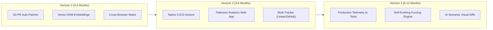

# Future Scope & Production Roadmap

> **Strategic Vision, Enterprise Roadmap, and Next-Generation Capabilities for Agentic-mesh**

---

## 1. Vision: The Autonomous QA Cloud

While Agentic-mesh already provides a fully functional, zero-touch testing and self-healing engine, the underlying architecture is designed to scale into an enterprise-grade **Autonomous Quality Platform**.

Our future vision transitions Agentic-mesh from a *reactive test repair tool* into an *active quality intelligence platform* that continuously synchronizes product specifications, frontend codebases, and test automation suites.



---

## 2. Roadmap Horizons

### 2.1 Horizon 1: Near-Term Engineering Enhancements (0 – 3 Months)

#### 1. Automated Git Pull Request Code Patching ("Write-Back to Repo")
- **Current Behavior**: Agentic-mesh self-heals broken locators in-memory during test runtime and logs repairs to `reports/repairs.jsonl`.
- **Planned Capability**: A GitHub App integration that automatically creates a Pull Request against the repository, updating the static test code files with the healed locators:
  ```diff
  - await page.locator('#login-btn').click();
  + await page.locator('#auth-submit-button').click(); // Auto-repaired by Agentic-mesh (Confidence: 0.88)
  ```
- **Impact**: Completely closes the loop—developers never have to manually edit test files after refactoring frontend components.

#### 2. Vector Embeddings for Interactive DOM Nodes
- **Current Behavior**: Ranks candidate elements via mathematical similarity (Levenshtein + Jaccard token overlap).
- **Planned Capability**: Ingest interactive DOM nodes into a lightweight in-memory vector index (e.g. using lightweight local embeddings like `all-MiniLM-L6-v2`).
- **Impact**: Enables sub-millisecond semantic element discovery even when labels, tags, and layouts undergo radical redesigns (e.g., matching a cart icon with an empty shopping bag SVG).

#### 3. Cross-Browser & Mobile Emulation Matrix
- **Current Behavior**: Executes tests on Chromium instances.
- **Planned Capability**: Extend `AgenticMeshRunner` to execute tests across Playwright's full matrix:
  - Firefox & WebKit (Safari).
  - Mobile device profiles (iPhone 15, Pixel 8, iPad Pro) with touch gesture emulation.
- **Impact**: Detects cross-browser locator inconsistencies and mobile-responsive layout breakages.

---

### 2.2 Horizon 2: Ecosystem & Enterprise Integration (3 – 6 Months)

#### 1. Native CI/CD Pipeline Plugins
- **GitHub Action**: `uses: agentic-mesh/action@v1` to trigger automated test synthesis and healing directly on every PR.
- **GitLab CI & Jenkins Plugins**: Built-in JUnit XML and SARIF output generators for seamless pipeline status reporting.
- **Slack & Microsoft Teams Alerts**: Real-time notifications summarizing pass rates and auto-repairs directly in engineering channels.

#### 2. Enterprise Flakiness & Quality Analytics Dashboard
- A centralized web dashboard displaying organizational QA metrics:
  - **Locator Drift Velocity**: Which frontend components change most frequently.
  - **Engineering Hours Saved**: Quantification of manual maintenance effort prevented.
  - **Flaky Index**: Historical heatmap identifying tests with high variance across builds.

#### 3. Multi-Tracker Support
- Expand beyond Jira Cloud to support:
  - **Linear** (via GraphQL API).
  - **GitHub Issues & Projects**.
  - **Asana** and **Monday.com**.

---

### 2.3 Horizon 3: Autonomous Quality Intelligence (6 – 12 Months)

#### 1. Production Telemetry to Synthetic Tests
- Ingest real user traffic patterns from tools like **Datadog**, **PostHog**, or **FullStory**.
- Agentic-mesh analyzes user funnels and automatically generates Playwright test suites covering the most critical and frequently traversed user journeys in production.

#### 2. Self-Evolving Fuzzing & Edge-Case Discovery
- Using reinforcement learning and LLM reasoning, Agentic-mesh explores applications autonomously—attempting unexpected inputs, boundary values, and race conditions to discover unhandled UI exceptions before users encounter them.

#### 3. Semantic Visual Regression Engine
- Move beyond pixel-based diffing to **semantic visual comprehension**.
- Distinguishes between intentional aesthetic changes (e.g. brand color update or dark mode) and genuine visual defects (e.g. overlapping text, broken flexbox wrappers, or clipped modals).

---

## 3. Summary

Agentic-mesh represents a foundational leap toward fully self-sustaining quality engineering. By combining fast heuristic pre-filtering, cutting-edge LLM reasoning, and enterprise issue tracking, Agentic-mesh eliminates the manual test maintenance burden and empowers engineering organizations to ship higher quality software with complete confidence.

