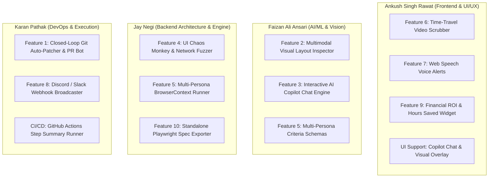

# Agentic-mesh: Advanced Features Roadmap & Team Execution Plan

> **Comprehensive Technical Specification, Architectural Blueprints, Resource Requirements, and Team Work Breakdown for Next-Generation Agentic-mesh Capabilities**

---

## 1. Executive Summary & Vision

Building on top of Agentic-mesh's core capabilities (Jira acceptance criteria ingestion, test synthesis, Playwright execution, zero-token heuristic self-healing, and Jira bug reporting), this document outlines **10 high-impact features** designed to elevate the platform into an enterprise-grade autonomous quality engineering suite.

Every feature in this specification is evaluated across:
* **Business & Technical Advantages**: Why the feature matters and the value it delivers.
* **Resource & Infrastructure Requirements**: Explicit API keys, npm libraries, or cloud resources needed.
* **Team Ownership**: Clean division of labor among **Ankush Singh Rawat**, **Faizan Ali Ansari**, **Jay Negi**, and **Karan Pathak**.

---

## 2. Master Feature Matrix & Team Allocation

| # | Feature Name | Primary Owner | Secondary / Co-Owner | Dev Effort | Impact Score | New Resources Needed |
| :-: | :--- | :--- | :--- | :-: | :-: | :--- |
| **1** | **Closed-Loop Git Auto-Patcher** | **Karan Pathak** *(DevOps)* | **Jay Negi** *(Runner Core)* | Medium (~3h) | 9.8 / 10 | 1 free GITHUB_TOKEN |
| **2** | **AI Multimodal Visual Layout Inspector** | **Faizan Ali Ansari** *(AI/ML)* | **Ankush Singh Rawat** *(UI)* | Med-Low (~2h) | 9.5 / 10 | Zero *(uses existing Gemini key)* |
| **3** | **Interactive "Ask Agentic-mesh AI Copilot"** | **Faizan Ali Ansari** *(AI/ML)* | **Ankush Singh Rawat** *(UI)* | Medium (~2h) | 9.5 / 10 | Zero *(uses existing Groq key)* |
| **4** | **UI Chaos Monkey & Network Fuzzer** | **Jay Negi** *(Backend/Engine)* | **Karan Pathak** *(DevOps)* | Medium (~3h) | 9.2 / 10 | Zero *(native Playwright CDP)* |
| **5** | **Multi-Persona Workflow Orchestrator** | **Jay Negi** *(Engine/Session)* | **Faizan Ali Ansari** *(AI)* | Medium (~3h) | 9.0 / 10 | Zero *(Playwright BrowserContext)* |
| **6** | **Time-Travel Video & DOM Scrubber** | **Ankush Singh Rawat** *(Frontend)* | **Jay Negi** *(Video Pipeline)* | Medium (~3.5h) | 9.0 / 10 | Zero *(Playwright recordVideo)* |
| **7** | **Browser Voice / Speech Synthesis Alerts** | **Ankush Singh Rawat** *(Frontend)* | None | Low (~15m) | 8.8 / 10 | Zero *(native Web Speech API)* |
| **8** | **Discord / Slack Webhook Broadcaster** | **Karan Pathak** *(DevOps)* | None | Low (~25m) | 8.5 / 10 | 1 free Webhook URL |
| **9** | **Financial ROI & Hours Saved Widget** | **Ankush Singh Rawat** *(Frontend)* | None | Low (~20m) | 8.5 / 10 | Zero *(pure math in Dashboard)* |
| **10** | **One-Click Playwright Spec Exporter** | **Jay Negi** *(Runner Core)* | **Ankush Singh Rawat** *(UI)* | Low (~30m) | 8.7 / 10 | Zero *(template string builder)* |

---

## 3. Detailed Feature Specifications

---

### Feature 1: Closed-Loop Git Auto-Patcher ("Write-Back to Repo")
* **Primary Owner:** Karan Pathak (DevOps & GitOps Lead)
* **Co-Owner:** Jay Negi (Runner & AST Integration)
* **Estimated Effort:** ~3 Hours

#### Description
When a selector breaks during CI/CD, Agentic-mesh's runtime self-healing repairs it on the fly so the build passes. However, the static test file on disk still contains the outdated locator. This feature closes the loop by automatically committing the healed locators back to Git.

#### Key Advantages
* **Eliminates Manual Selector Maintenance:** Developers never have to manually edit test files after CSS/DOM refactorings.
* **Safe, Auditable Git Workflows:** Changes are pushed to an isolated branch with automated Pull Requests containing side-by-side diffs and confidence scores.
* **Zero CI Blockers:** Non-breaking UI updates never block urgent deployments.

#### Requirements & Resources
* **API Keys / Credentials:** 1 GitHub Personal Access Token (GITHUB_TOKEN with repo scope).
* **Libraries:** Native git CLI (via Node.js child_process.execFile) or @octokit/rest.
* **Zero Paid Services:** Works with any standard GitHub or GitLab repository.

#### Implementation Blueprint
```typescript
// scripts/gitPatch.ts - Owned by Karan Pathak
import { execFile } from "child_process";
import { promisify } from "util";
const exec = promisify(execFile);

export async function createHealedPR(runId: string, repairs: Array<{ oldLocator: string; newLocator: string; file: string }>) {
  const branch = `fix/agentic-mesh-repair-${runId.slice(0, 8)}`;
  await exec("git", ["checkout", "-b", branch]);
  
  for (const repair of repairs) {
    // AST / Regex replacement of oldLocator -> newLocator in target test file
  }
  
  await exec("git", ["commit", "-am", `chore(qa): auto-repair locators via Agentic-mesh [Run: ${runId}]`]);
  await exec("git", ["push", "-u", "origin", branch]);
  // Open GitHub PR via REST API
}
```

---

### Feature 2: AI Multimodal Visual Layout & UX Defect Inspector
* **Primary Owner:** Faizan Ali Ansari (AI/ML & Vision Lead)
* **Co-Owner:** Ankush Singh Rawat (Frontend UI Integration)
* **Estimated Effort:** ~2 Hours

#### Description
Functional tests often pass even when the interface is visually corrupt (such as overlapping text, truncated labels, misaligned flex containers, or modal overlays blocking user interaction). This engine captures full-page viewport screenshots and leverages Google Gemini 2.5 Flash vision to audit layout integrity.

#### Key Advantages
* **Discovers Bugs DOM Assertions Miss:** Flags CSS layout breakages, responsive styling clipping, and text overlapping that code assertions cannot detect.
* **Autonomous UX Scoring:** Grades the rendered page on readability, visual hierarchy, and contrast.
* **Integrated with Jira:** Automatically attaches annotated visual bug reports to Jira tickets.

#### Requirements & Resources
* **API Keys:** Uses existing GEMINI_API_KEY already configured in .env.
* **Libraries:** @google/genai (already installed in package.json).
* **Cost:** $0.00 (Gemini 2.5 Flash free/developer tier has high rate limits).

#### Implementation Blueprint
```typescript
// src/llm/visualAuditor.ts - Owned by Faizan Ali Ansari
import { GoogleGenAI } from "@google/genai";

export async function auditVisualLayout(screenshotBuffer: Buffer, contextDescription: string) {
  const ai = new GoogleGenAI({ apiKey: process.env.GEMINI_API_KEY! });
  const response = await ai.models.generateContent({
    model: "gemini-2.5-flash",
    contents: [
      { inlineData: { mimeType: "image/png", data: screenshotBuffer.toString("base64") } },
      `Analyze this UI screenshot for visual bugs during: "${contextDescription}".
       Check for: 1) Overlapping elements, 2) Text truncation, 3) Broken CSS layouts, 4) Modal blocking issues.
       Return JSON matching: { hasVisualDefect: boolean, defects: string[], severity: "low"|"medium"|"high" }`
    ]
  });
  return JSON.parse(response.text);
}
```

---

### Feature 3: Interactive "Ask Agentic-mesh AI Copilot" (In-Context Run Chat)
* **Primary Owner:** Faizan Ali Ansari (Prompt Engineering & LLM Backend)
* **Co-Owner:** Ankush Singh Rawat (Web Console Chat Drawer UI)
* **Estimated Effort:** ~2 Hours

#### Description
A slide-over AI Copilot drawer in the Web Console (web/src/pages/RunReport.tsx). Developers and QA engineers can converse directly with an AI agent equipped with the full execution context (test steps, DOM mutations, stack traces, and healing heuristics).

#### Key Advantages
* **Conversational Root Cause Analysis:** Ask "Why did the checkout button click fail?" and receive plain-English diagnosis.
* **Component Fix Suggestions:** Ask "Show me how to refactor my React button component so this locator stops breaking".
* **Interactive Triage:** Eliminates hours spent parsing terminal stack traces.

#### Requirements & Resources
* **API Keys:** Uses existing GROQ_API_KEY (llama-3.3-70b-versatile) already in .env.
* **Libraries:** Standard Fastify route + React Lucide icons (MessageSquare, Bot).
* **Cost:** $0.00 (Included in existing Groq quota).

---

### Feature 4: Autonomous UI Chaos Monkey & Network Flakiness Fuzzer
* **Primary Owner:** Jay Negi (Backend & Engine Architecture)
* **Co-Owner:** Karan Pathak (Playwright Hooks & CDP)
* **Estimated Effort:** ~3 Hours

#### Description
Tests often fail randomly due to network jitter, server hiccups, or race conditions. This feature injects controlled chaos during Playwright test runs to evaluate whether frontend applications degrade gracefully or crash.

#### Key Advantages
* **Network Throttling Simulation:** Simulates Slow 3G, dropped TCP packets, and sudden 504 Gateway Timeouts via Playwright page.route().
* **Behavioral Fuzzing:** Simulates rapid double-clicking (race-condition attacks) on submit buttons.
* **Dirty Input Injection:** Injects boundary strings (emojis, unicode, 10k-character strings, SQL/XSS tokens) into text inputs.
* **Resilience Score Card:** Calculates a "Stability Score (A to F)" for the tested application.

#### Requirements & Resources
* **API Keys:** None (100% local execution).
* **Libraries:** Native Playwright CDP (page.route(), page.setViewportSize()).

---

### Feature 5: Multi-Persona / Multi-Role Workflow Orchestrator
* **Primary Owner:** Jay Negi (Session & BrowserContext Management)
* **Co-Owner:** Faizan Ali Ansari (Test Case Schema Extensions)
* **Estimated Effort:** ~3 Hours

#### Description
Enterprise acceptance criteria frequently require multi-user collaboration (for example: Buyer places an order -> Seller views order in merchant portal -> Admin approves refund). This engine orchestrates multiple concurrent BrowserContext sessions (isolated cookies, auth tokens, and local storage) in a single test sequence.

#### Key Advantages
* **True End-to-End Business Testing:** Tests complex workflows that single-user test scripts cannot touch.
* **Zero Session Leakage:** Separate browser contexts guarantee zero token or cookie contamination between roles.
* **Synchronized State Assertions:** Verifies that actions by Persona A immediately reflect in Persona B's portal.

#### Requirements & Resources
* **API Keys:** None.
* **Libraries:** Native Playwright browser.newContext() and existing src/utils/tab-manager.ts.

---

### Feature 6: Interactive "Time-Travel" Video & DOM Scrubber
* **Primary Owner:** Ankush Singh Rawat (Frontend UI/UX Lead)
* **Co-Owner:** Jay Negi (Video Pipeline & Artifact Storage)
* **Estimated Effort:** ~3.5 Hours

#### Description
An interactive multimedia scrubber in the Web Console report view. Instead of static screenshot thumbnails, engineers can scrub through a synchronized video recording of the test run, with timeline markers indicating the exact millisecond when locators broke and healed.

#### Key Advantages
* **Sub-Second Visual Replay:** See the exact animation, dropdown transition, or DOM mutation that triggered a locator failure.
* **Side-by-Side Diagnostics:** Video scrubber automatically highlights the active step description, console logs, and network requests for that exact frame.
* **Flakiness Diagnosis:** Immediately distinguishes between timing issues (element took 2.5s to appear) and structural bugs (element was missing).

#### Requirements & Resources
* **API Keys:** None.
* **Libraries:** Playwright recordVideo (already built into src/video.ts), HTML5 video element with custom React timeline controls.

---

### Feature 7: Browser Voice / Speech Synthesis Real-Time Alerts
* **Primary Owner:** Ankush Singh Rawat (Frontend UI/UX Lead)
* **Estimated Effort:** ~15 Minutes

#### Description
Integrates the native browser Web Speech API (window.speechSynthesis) into the Live Run view. Agentic-mesh speaks aloud critical milestones during live runs (for example: "Warning: Locator failed on login button. Agentic-mesh autonomously healed selector with 94% confidence." or "Critical 500 error encountered. Jira ticket SQA-42 filed.").

#### Key Advantages
* **Live Demo Impact:** Immediately commands the attention of professors, judges, or engineering leads during presentations.
* **Headless / Background Awareness:** Engineers can listen to test suite progress while working in other tabs or IDEs.

#### Requirements & Resources
* Zero npm packages, zero API keys, 6 lines of pure TypeScript in web/src/hooks/useLiveVoice.ts.

---

### Feature 8: Discord / Slack / Teams Webhook Incident Broadcaster
* **Primary Owner:** Karan Pathak (DevOps & Integrations Lead)
* **Estimated Effort:** ~25 Minutes

#### Description
Pushes real-time, cleanly formatted rich embed cards to Discord, Slack, or MS Teams channels whenever a test suite completes or an unrecoverable crash occurs.

#### Key Advantages
* **Instant Team Transparency:** QA and development teams receive instant notifications with pass rates, healing counts, and direct links to Jira tickets.
* **Actionable Cards:** Color-coded (Green for pass, Red for fatal crash, Amber for healed).

#### Requirements & Resources
* **Credentials:** 1 free Discord or Slack Webhook URL added to .env (DISCORD_WEBHOOK_URL).
* **Libraries:** Native Node.js fetch.

---

### Feature 9: Financial ROI & Engineering Hours Saved Widget
* **Primary Owner:** Ankush Singh Rawat (Frontend UI/UX Lead)
* **Estimated Effort:** ~20 Minutes

#### Description
A prominent financial metric card on the Web Console Dashboard that calculates the business value delivered by autonomous self-healing:
* **Triage Time Saved:** Healed Selectors * 15 minutes (industry average manual selector triage).
* **Capital Saved:** Hours Saved * $65/hr (standard developer rate).
* **Token Cost Savings:** Number of repairs resolved at $0.00 token cost via mathematical heuristic similarity.

#### Key Advantages
* **Executive Appeal:** Quantifies cost and time savings directly for leadership and evaluators.
* **Zero-Token Highlighting:** Directly proves the efficiency of Agentic-mesh's Healenium similarity matrix.

#### Requirements & Resources
* Zero new packages or keys (pure calculation inside web/src/pages/Dashboard.tsx from existing repairs array).

---

### Feature 10: One-Click Standalone Playwright Spec Exporter (.spec.ts)
* **Primary Owner:** Jay Negi (Runner Core & Export Utility)
* **Co-Owner:** Ankush Singh Rawat (UI Button & Download Action)
* **Estimated Effort:** ~30 Minutes

#### Description
Adds an "Export Playwright Spec" button on the Run Report page. With a single click, it compiles the synthesized steps—including all newly healed locators—into a clean, standalone TypeScript file (tests/generated.spec.ts) ready to be copied into any existing Playwright repo.

#### Key Advantages
* **Immediate Developer Utility:** Developers can run the healed tests locally using npx playwright test without needing the full Agentic-mesh server.
* **Exportable IP:** Bridges Agentic-mesh's AI test synthesis directly into standard enterprise test repositories.

#### Requirements & Resources
* Zero new packages or keys (template string generator reading existing TestCase objects).

---

## 4. Team Responsibilities & Work Allocation Summary



---

## 5. Phased Implementation Roadmap (Sprints)

### Sprint 1: Rapid High-Impact Wins (Elapsed Time: ~1.5 Hours)
* **Ankush:** Build Web Speech Audio Alerts (Feature 7) + ROI Savings Widget (Feature 9).
* **Jay:** Build One-Click Playwright Spec Exporter (Feature 10).
* **Karan:** Build Discord / Slack Webhook Broadcaster (Feature 8).

### Sprint 2: Core Intelligent Additions (Elapsed Time: ~4 Hours)
* **Faizan & Ankush:** Build AI Multimodal Visual Layout Inspector (Feature 2) + Interactive Copilot Chat Drawer (Feature 3).
* **Jay & Karan:** Build UI Chaos Monkey & Network Flakiness Fuzzer (Feature 4).

### Sprint 3: Deep Autonomous Systems (Elapsed Time: ~6 Hours)
* **Karan & Jay:** Build Closed-Loop Git Auto-Patcher PR Engine (Feature 1).
* **Jay & Faizan:** Build Multi-Persona Workflow Orchestrator (Feature 5).
* **Ankush:** Build Interactive Time-Travel Video & DOM Scrubber (Feature 6).
