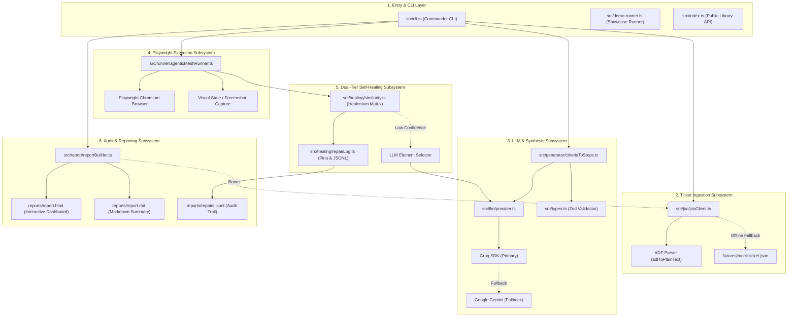
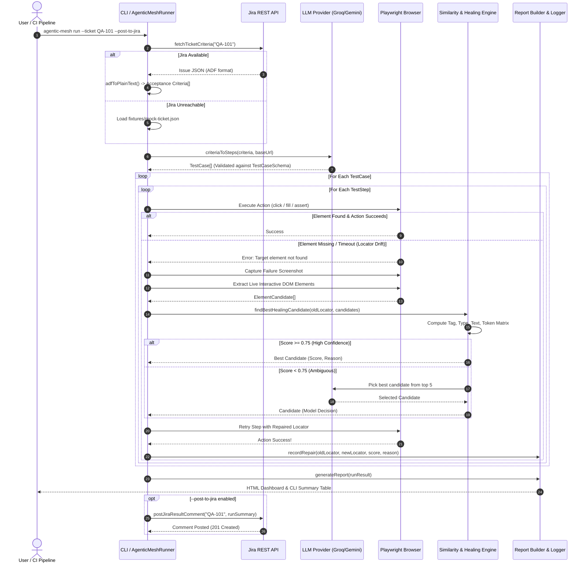
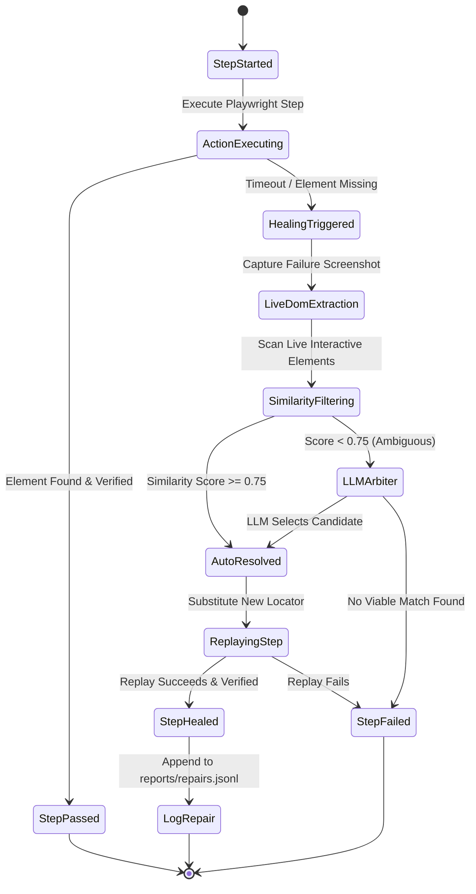

# System Architecture

> **Component Architecture, Interaction Sequences, State Machines, and Data Flow in Agentic-mesh**

---

## 1. High-Level Component Architecture

Agentic-mesh is organized into six decoupled, modular subsystems. Each subsystem has a single responsibility, cleanly defined interfaces, and comprehensive test coverage.



---

## 2. End-to-End Sequence Diagram

The following sequence diagram illustrates the lifecycle of a test execution, from Jira criteria retrieval to self-healing and Jira comment write-back.



---

## 3. Self-Healing State Machine

The self-healing subsystem governs how test steps transition between operational states:



---

## 4. Subsystem & Module Responsibilities

### 4.1 CLI & Entry Layer
- [`src/cli.ts`](src/cli.ts): Commander.js CLI defining flags (`--ticket`, `--url`, `--mock`, `--post-to-jira`, `--repeat`, `--headless`, `--output-dir`).
- [`src/demo-runner.ts`](src/demo-runner.ts): 6-phase automated comparison script showcasing `v1` baseline vs `v2` refactor self-healing.
- [`src/index.ts`](src/index.ts): Central re-export of all core and legacy engine modules.

### 4.2 Ticket Ingestion Layer
- [`src/jira/jiraClient.ts`](src/jira/jiraClient.ts):
  - `fetchTicketCriteria()`: Queries Jira REST API via `jira.js` with ADF parsing.
  - `adfToPlainText()`: Recursively extracts text from nested Atlassian Document Format nodes.
  - `extractCriteria()`: Heuristic extractor for bulleted and numbered acceptance criteria.
  - `postJiraResultComment()`: Submits markdown-formatted execution results as Jira issue comments.
- [`fixtures/mock-ticket.json`](fixtures/mock-ticket.json): Offline fallback ticket with 4 realistic acceptance criteria (Login Success, Login Failure, Add Task, Logout).

### 4.3 LLM Orchestration Layer
- [`src/llm/provider.ts`](src/llm/provider.ts):
  - Primary provider: Groq SDK (`openai/gpt-oss-120b`, `qwen/qwen3.8-27b`).
  - Secondary fallback: Dynamic import of Google Gemini (`@google/genai`).
  - Robust JSON parser with markdown fence stripping and schema retry logic.
- [`src/generator/criteriaToSteps.ts`](src/generator/criteriaToSteps.ts):
  - `criteriaToSteps()`: Maps criteria to structured `TestCase[]` with atomic Playwright actions.
  - `deterministicCriteriaToSteps()`: Offline rule-based fallback when no LLM API is available.
- [`src/types.ts`](src/types.ts): Zod schemas (`TicketSchema`, `TestCaseSchema`, `RepairRecordSchema`, `TestResultSchema`, `ElementCandidate`).

### 4.4 Execution & Healing Layer
- [`src/runner/agenticMeshRunner.ts`](src/runner/agenticMeshRunner.ts):
  - Playwright browser lifecycle manager.
  - In-browser candidate extraction via `page.evaluate()`.
  - Visual screenshot capture (baseline and failure states).
  - Flaky test detection multi-run loop.
- [`src/healing/similarity.ts`](src/healing/similarity.ts):
  - `computeSimilarity()`: Multi-attribute scoring matrix (Tag, Type, Text, Token Overlap).
  - `findBestHealingCandidate()`: Ranks live DOM candidates and returns top candidates.
- [`src/healing/repairLog.ts`](src/healing/repairLog.ts):
  - Appends structured records to `reports/repairs.jsonl`.
  - Emits formatted Pino logs.

### 4.5 Reporting Layer
- [`src/report/reportBuilder.ts`](src/report/reportBuilder.ts):
  - Generates self-contained HTML dashboard with embedded CSS/JS (`reports/report.html`).
  - Generates GitHub-flavored Markdown summary (`reports/report.md`).
  - Renders colored CLI summary tables via console.

---

## 5. Data Flow & Artifact Persistence

```
[Inputs]
  ├── Jira REST API / mock-ticket.json
  └── CLI flags (--ticket, --url, --repeat)
       │
[Runtime Memory State]
  ├── Ticket { key, title, criteria[] }
  ├── TestCase[] { id, name, steps[] }
  └── ElementCandidate[] { selector, tag, text, attributes }
       │
[Output Artifacts]
  ├── reports/report.html      <- Interactive visual dashboard with diff modal
  ├── reports/report.md        <- Markdown summary table
  ├── reports/repairs.jsonl    <- Immutable append-only repair audit trail
  └── reports/screenshots/     <- Failure and before/after screenshot comparisons
```

